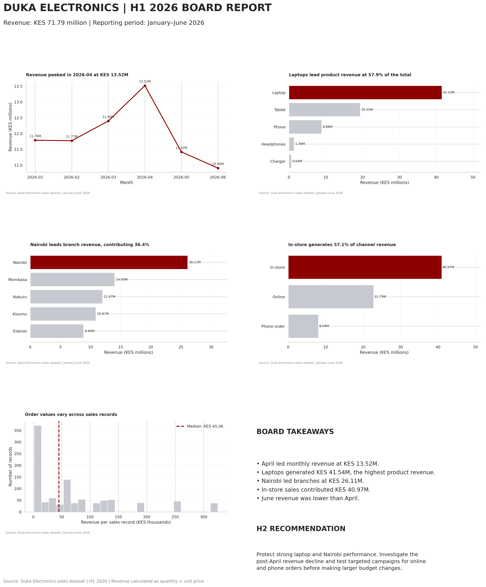

# Duka Board Report — H1 2026

## Board Report

## Board Summary

Duka Electronics generated KES 71.79 million in revenue during H1 2026. April was the strongest month, contributing KES 13.52 million, while June recorded the lowest monthly revenue at KES 10.90 million. Laptops led product performance with KES 41.54 million, followed by tablets at KES 19.35 million. Nairobi was the highest-performing branch, generating KES 26.11 million, while Eldoret recorded KES 8.84 million. In-store sales contributed KES 40.97 million, compared with KES 22.79 million online and KES 8.04 million through phone orders.

For H2 2026, the board should protect the strong laptop category and review opportunities in Nairobi while investigating the decline in monthly revenue after April. Management should test targeted campaigns to grow online and phone-order sales, assess the causes of lower performance in Eldoret, and monitor results before committing additional budget. These actions should be evaluated using monthly revenue, branch performance, product mix, and channel contribution to guide evidence-based decisions.

## Project Files

* `board_report.ipynb` — analysis, visualizations, and design comparison.
* `reports/duka_board_report.png` — one-page board report.
* `figures/before.png` and `figures/after.png` — visualization design comparison.
* `requirements.txt` — Python dependencies.

## Tools Used

Python, pandas, matplotlib, and seaborn.
