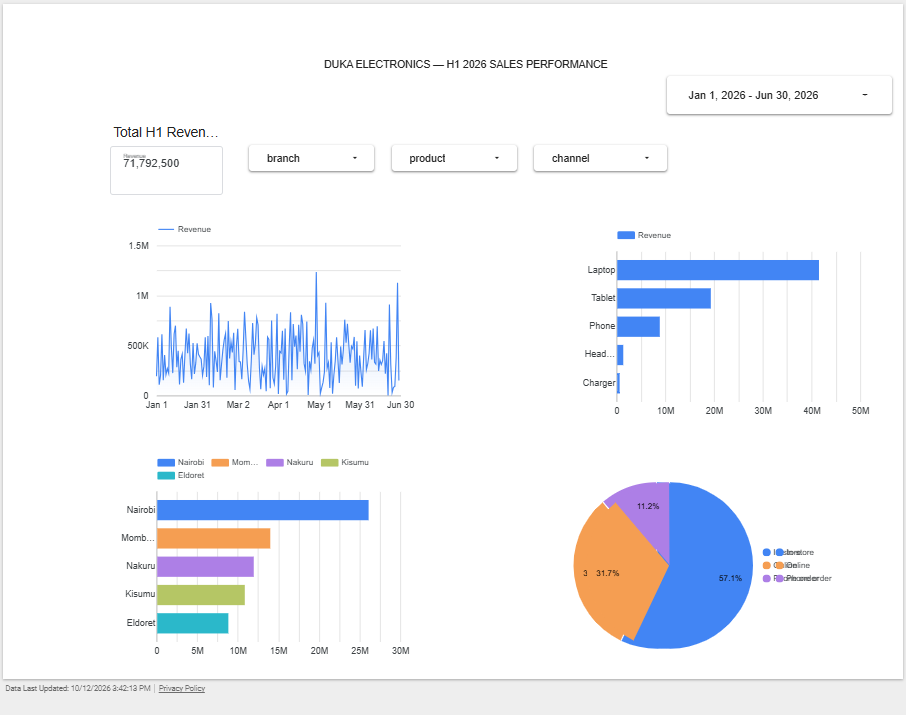
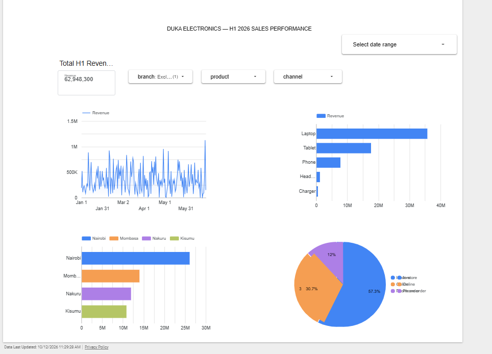

# Duka Electronics Dashboard — H1 2026

## Dashboard Purpose

This dashboard presents Duka Electronics' sales performance for January–June 2026. It is intended to help the CEO and board make informed decisions about the H2 2026 budget

## Dashboard Link

[Open the Duka Electronics H1 2026 Dashboard](https://datastudio.google.com/reporting/79fb0332-1dce-473c-81cc-bbd1b9cbc753)

## Required Dashboard Components

* **Scorecards:** Total H1 revenue and key sales performance indicators.
* **Monthly trend:** Revenue by month from January to June 2026.
* **Product breakdown:** Revenue by product category.
* **Branch breakdown:** Revenue by branch.
* **Sales channel breakdown:** Revenue by sales channel.
* **Filters:** Date, branch, product, and sales channel where available.

## Dashboard Screenshots

### Screenshot 1 — Overview

### Screenshot 2 — Sales Breakdown

## Key Business Question

How should Duka Electronics allocate its H2 2026 budget based on H1 sales performance?

## Important Note

Replace the placeholder dashboard URL and screenshot sections with the actual published Looker Studio link and screenshots before submitting the assignment.
